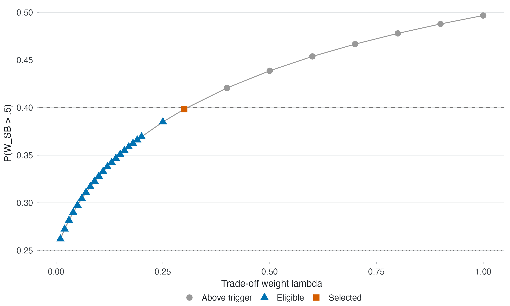

# Prior elicitation

We specify a Gamma hyperprior for the concentration parameter using shape $a$ and rate $b$, so that $E(\alpha)=a/b$. The number $J$ of exchangeable units is part of the specification. For example, a prior calibrated to give five clusters among 50 sites will generally imply a different count among 500 examinees.

## Match the count judgment

The following commands fit a prior for $J=50$, a target mean count of 5 and a target variance of 10:

~~~bash
Rscript 00_setup.R --profile calibration
Rscript calibration/01_count_calibration.R
~~~

At a fixed concentration parameter, the expected count is

$$E(K_J\mid\alpha)=\sum_{j=1}^{J}\frac{\alpha}{\alpha+j-1}.$$

We integrate the count moments over the Gamma hyperprior and choose $a$ and $b$ to match the two targets. Two-Stage Moment Matching (TSMM) uses an approximate solution as a starting value, then refines it using the exact finite-sample moments. In this example, the final values are approximately $(a,b)=(1.4082,1.0770)$.

The [calibration script](code/calibration/01_count_calibration.R) reports both stages and checks the final moments at a higher quadrature order. Numerical settings are collected in the [policy file](records/calibration-policy.yml) and applied by the [calibration functions](code/calibration/policy_helpers.R).

## Examine the weights

~~~bash
Rscript calibration/02_weight_diagnostics.R
~~~

The size-biased weight is the population weight of the cluster containing a randomly selected unit. Under the Gamma hyperprior, its tail probability is

$$\Pr(W_{\mathrm{SB}}>t)=\left\{\frac{b}{b-\log(1-t)}\right\}^{a}.$$

This quantity describes a different selection of a cluster from choosing the largest population cluster. Both also differ from the largest observed allocation share, which depends on the finite sample. The [weight script](code/calibration/02_weight_diagnostics.R) calculates these functionals and the bounds used to compare them.

## Apply the Dual-Anchor procedure

~~~bash
Rscript calibration/03_dual_anchor.R
Rscript calibration/04_hard_and_failures.R
~~~

For the count-calibrated prior above, the probability that the size-biased weight exceeds one half is about .497. This exceeds the specified tolerance of .40. We therefore consider 29 values of the weight $\lambda$ that controls the balance between count and weight losses. The loss scales are held fixed across these candidates.

We select the largest eligible $\lambda$ for which the majority probability is at most .40. Eligibility requires an interior solution and successful numerical verification. The selected value is $\lambda=.30$, with $(a,b)\approx(2.3158,1.4204)$ and a majority probability of about .398.

The weight loss uses .25 as a target, whereas .40 determines whether a candidate meets the stated tolerance. Requiring the probability to be at most .25 is a separate, more restrictive calculation; it produces a substantially larger expected count. The second script examines this constraint and cases in which no candidate is eligible. In the latter case, the procedure returns no prior.

Run `calibration/05_confidence_levels.R` to compare four confidence settings at $J=100$. The standard figure build uses the supplied calibration results, so optimization need only be repeated when examining the elicitation itself.

[Worked-example table](artifacts/osm-table-G.1.html) · [Numerical results](artifacts/osm-table-G.1.csv)
