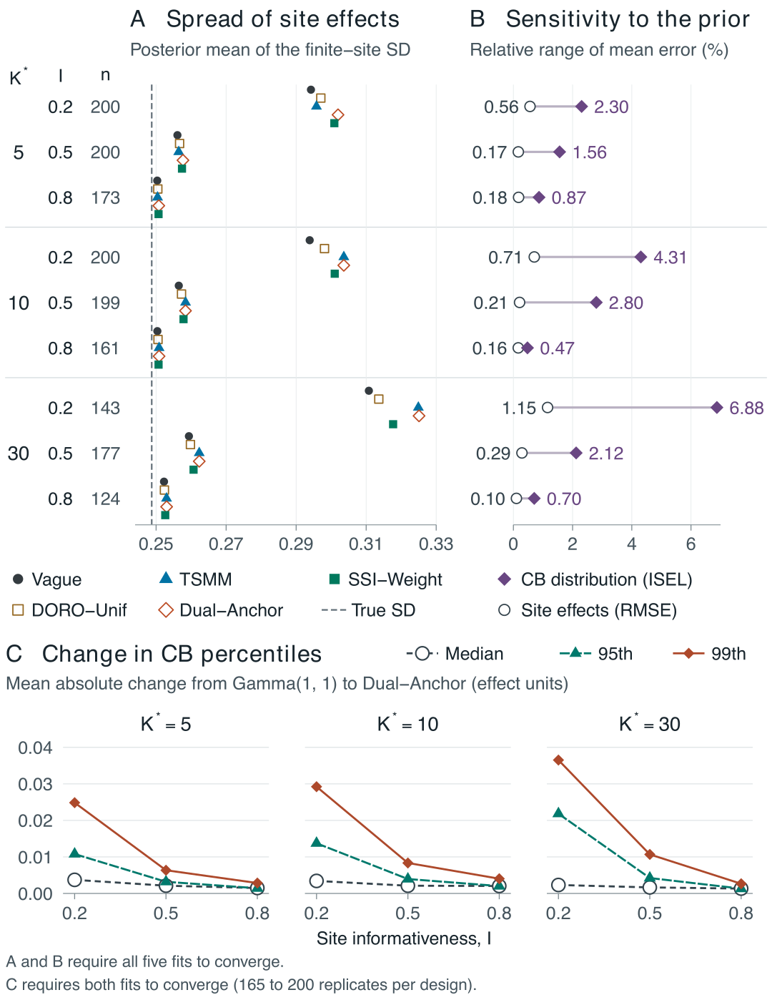

# Simulation study

Each design varies the generating number of clusters, the informativeness of the site effects and the concentration prior. The simulation draws effects for a fixed sample of sites. The data generator centers the true effects and rescales their sample SD to 0.25 using denominator $J-1$. Summaries of spread across the observed sites use denominator $J$. [Data generator](code/refit/simulation/dgp.R)

## Reconstruct Table 3 and Figure 4

The full design contains 322 conditions and 64,400 planned fits. Calibration excluded 2,800 before sampling. Final convergence checks excluded another 4,449. The main $N(0,1)$ comparison retains 8,607 of 9,000 fits across 45 conditions. Each design has 200 attempted replications under each prior. Table 3 and Tables F.12–F.14 use the converged fits for each prior separately. At $K^*=5$ and $I=0.2$, Gamma(1,1) gives mean cluster count 1.50, one-cluster probability 0.725 and mean count-interval width 3.60 over 200 fits. [Table 3](artifacts/main-table-3.html) · [Denominators](artifacts/osm-table-F.5.html)

Panels A and B match synthetic datasets for which all five priors converged. Each design contributes 124–200 such datasets. At $I=0.2$, the between-prior ranges of the integrated squared error for the site posterior means are 2.30%, 4.31% and 6.88% for generating counts of 5, 10 and 30. The corresponding ranges of site-level RMSE are 0.56%, 0.71% and 1.15%. The tables retain both posterior-mean (PM) and constrained Bayes (CB) distribution errors. [Table F.12](artifacts/osm-table-F.12.html)

Panel C uses the 1,681 datasets in which both Gamma(1,1) and Dual-Anchor converged, with 165–200 per design. Effects are matched by percentile within the same synthetic dataset. At $I=0.2$, the mean absolute movement at the 99th percentile is about 0.025–0.037. The signed change is Dual-Anchor minus Gamma. Bias, MAE and RMSE instead compare each estimate with the true percentile. The reproducing code joins by fit key, design, replication and synthetic-data fingerprint. [Figure 4 renderer](code/simulation/exhibits/figure4.R) · [Simulation calculation](code/simulation/exhibits/build.R) · [Percentile calculation](code/simulation/exhibits/percentiles.R) · [Table F.16](artifacts/osm-table-F.16.html)

## Inspect a replayed posterior CDF

For two low-information datasets, the archived replay records support the posterior mean finite-site CDF and the GR empirical CDF. The four selected fits are TSMM and Dual-Anchor for $K^*=5$, and Gamma(1,1) and TSMM for $K^*=30$, each at replication 1. The supplied coordinates and distance summaries rebuild the two examples. Other designs have synthetic site vectors, posterior site means and CB estimates. [Figure F.5](artifacts/osm-figure-F.5.png) · [Table F.15](artifacts/osm-table-F.15.html)

## Inspect the design extensions

The three grand-mean variance settings, .01, 1 and 100, reuse the same synthetic datasets. Figure F.1 shows paired changes and the 2.5th–97.5th percentile range of these changes. Figure F.2 and Table F.7 use complete trajectories for elicited-mean misspecification. Figure F.3 and Tables F.8–F.9 give design-size comparisons, including the smaller admitted counts at $J=200$. Table F.10 compares the location of a 60% component. Table F.11 compares the selected $\lambda=.16$ with fixed values .50 and .90. [Figure F.1](artifacts/osm-figure-F.1.png) · [Table F.7](artifacts/osm-table-F.7.html) · [Table F.11](artifacts/osm-table-F.11.html)

The top-level build runs the simulation calculations. To repeat only the newer distribution and percentile calculations once the initial summaries exist, run the following command.

~~~sh
Rscript simulation/exhibits/build.R
~~~
