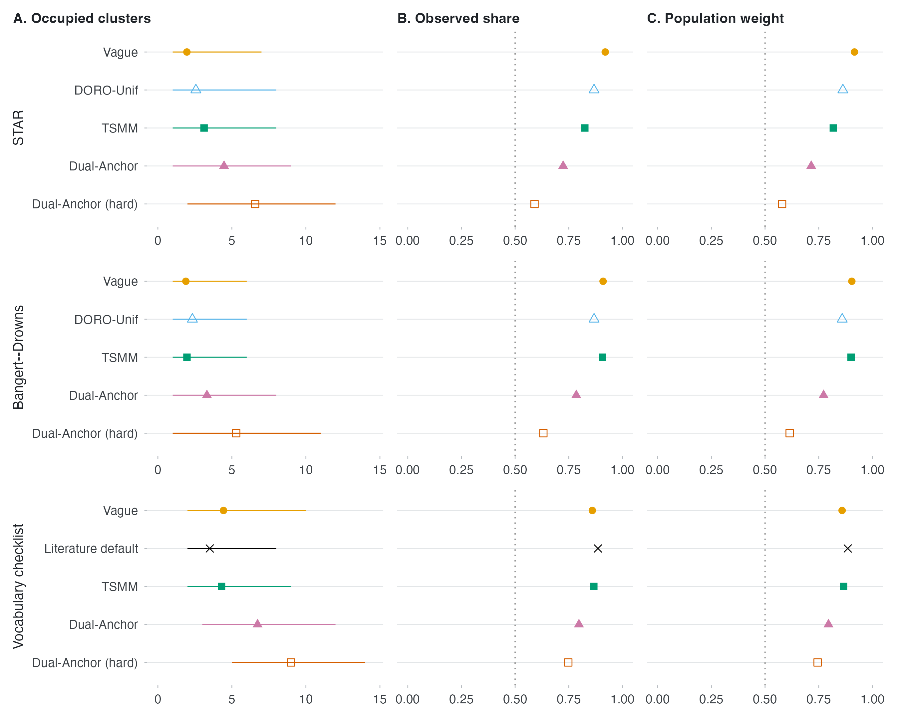

# Applications

We examine how the concentration hyperprior affects the inferred partition and the estimates for individual schools or studies. Figure 7 compares the cluster counts, largest observed shares and largest population weights. The last two quantities distinguish the fitted sample partition from the population distribution.

## Project STAR

After obtaining `mlmRev` 1.0-9, run:

~~~bash
Rscript applications/01_prepare_public_data.R
Rscript applications/02_first_stage.R
~~~

The source contains 6,325 kindergarten records. Complete-case selection leaves 5,786 pupils in 337 classrooms and 79 schools. We pool the two regular-class arms and standardize the outcome over the retained sample. The primary estimates of school effects account for classroom dependence. We also fit schoolwise OLS regressions with HC3 standard errors to examine sensitivity to this treatment of first-stage uncertainty.

The normal random-effects estimate is approximately .194, with a 95% interval of [.097,.291]. Under Vague, TSMM and Dual-Anchor, the posterior single-cluster probabilities are .560, .200 and .064. Despite this difference, the school-mean RMSD between Dual-Anchor and Vague is only .0088 standard deviations. Replacing the primary first stage with HC3 has a larger effect, giving RMSDs of .169–.174 across priors. [OSM Table H.4](artifacts/osm-table-H.4.html) reports this comparison separately from sensitivity to the model's scale parameters.

The [first-stage functions](code/applications/first_stage.R) give the standardization and regression calculations. The [data loader](code/applications/data_loaders.R) checks the sample. The location-profile intervals in [OSM Table H.6](artifacts/osm-table-H.6.html) use the original joint posterior summaries, since they cannot be reconstructed by averaging marginal interval endpoints.

## Writing-to-learn meta-analysis

The same preparation command reads 48 study effects from `metadat::dat.bangertdrowns2004`, version 1.6-0. We use the supplied effect estimates and sampling variances. Their bias correction and equal-group-size assumption are described in the [dataset documentation](https://wviechtb.github.io/metadat/reference/dat.bangertdrowns2004.html).

Dual-Anchor gives a posterior mean count of about 3.31 and a single-cluster probability of .190, compared with .548 under Vague and .525 under TSMM. Its posterior probability that the largest population weight exceeds one half is .863. The expectation of $.5^\alpha$, calculated from the marginal posterior of $\alpha$, is .520. This latter functional omits the further information about the weights in the observed data. [OSM Table H.2](artifacts/osm-table-H.2.html) reports both quantities. The associations with grade and intervention length in [Table H.7](artifacts/osm-table-H.7.html) are descriptive, unadjusted comparisons.

## Online Credit Recovery Study

Download the AIR/ICPSR impact file described in the [data chapter](02-data-and-scope.qmd), then run:

~~~bash
Rscript applications/05_prepare_ocrs.R --input "/path/to/OCRS_publicuse_impactanalysisdata.csv"
~~~

The [preparation script](code/applications/05_prepare_ocrs.R) retains 1,063 complete-case observations and calculates effects for 24 schools. The source contains 1,737 subject-level observations from 1,683 students; a student can contribute observations for more than one subject. We standardize `sts_irtscore` over the retained observations, identify treatment by `ragrp == 1`, and fit a contrast within each school identified by `studyschids`.

This analysis estimates descriptive schoolwise contrasts among complete cases. The original study's blocked, covariate-adjusted intention-to-treat analysis has a different target. The preparation script compares each effect and variance with the inputs used here. [OSM Table H.5](artifacts/osm-table-H.5.html) gives the calibration and posterior results.

## Reconstruct the posterior comparisons

~~~bash
Rscript applications/03_summaries.R
Rscript applications/04_sensitivity.R
Rscript applications/06_supplemental.R
Rscript verification/check_applications.R
~~~

These commands use the supplied model summaries. They cover 35 fits: 15 primary, 15 with wider scale parameters and five STAR HC3 fits. Twenty-five use the initial run and ten use a rerun; each contributes 16,000 retained draws. Diagnostic summaries record the earlier attempts as well. [Tables 4](artifacts/main-table-4.html) and [5](artifacts/main-table-5.html) present the prior implications and posterior results, respectively.
