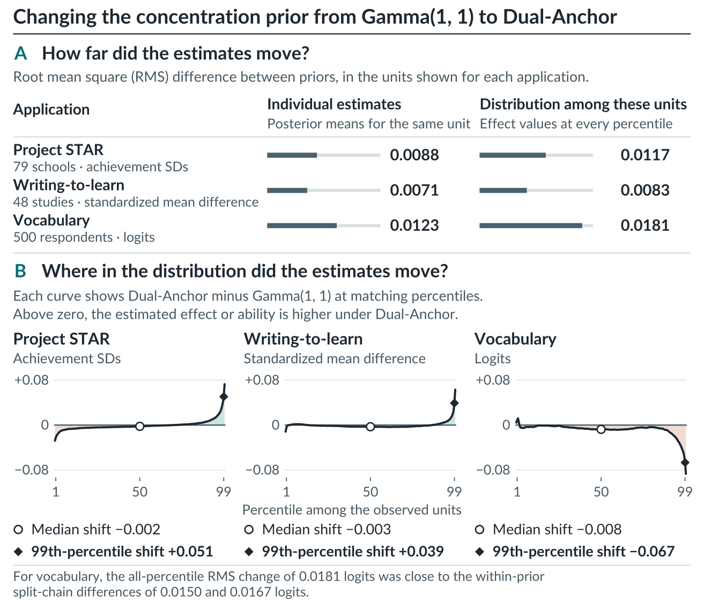
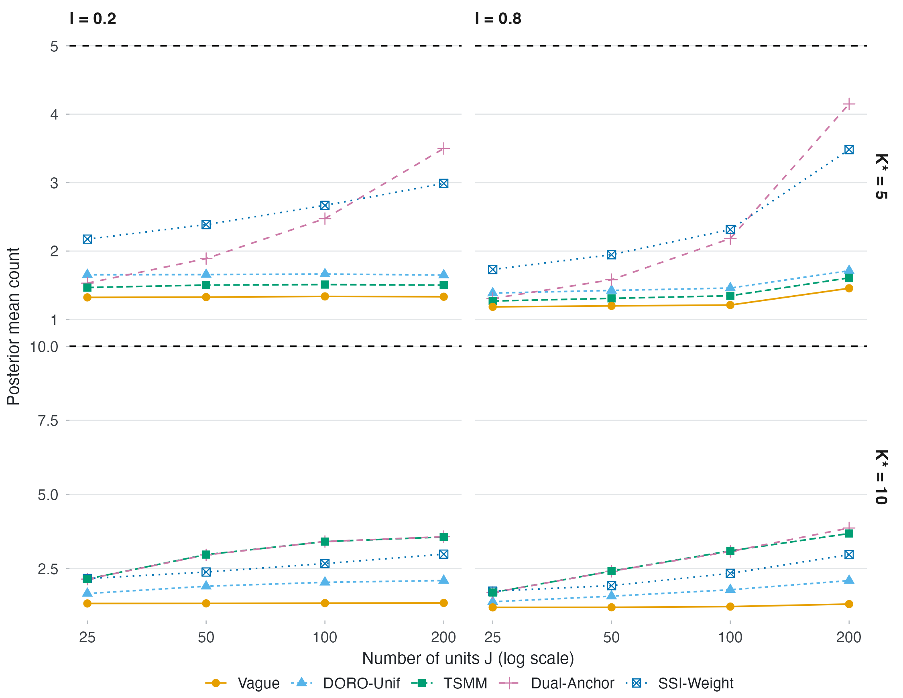

# Applications

Table 4 aligns the three applications under Gamma(1,1), TSMM and Dual-Anchor. For each fit the prior columns report the expected cluster count and the probability that the size-biased population weight exceeds one half. The posterior columns report the mean count, single-cluster probability, largest population weight and finite-sample SD. Tables H.3 and H.4 also give the external reference and hard sensitivity prior. [Table 4](artifacts/main-table-4.html) · [Table H.3](artifacts/osm-table-H.3.html) · [Table H.4](artifacts/osm-table-H.4.html)

## Match units and percentiles

Panel A first compares the posterior means of the same school or study under the two priors. For vocabulary, the calculation weights 14 raw-score-group EAP differences by their respondent counts. The second comparison inverts the posterior mean finite CDF over all observed units. It matches every rank, pools squared differences and takes the square root of their mean. For STAR the two RMS values are 0.0088 and 0.0117 achievement SDs. Figure 5B shows the signed change in the matched percentile, Dual-Anchor minus Gamma, at 199 ranks. The 99th percentile rises by 0.051 for STAR and 0.039 for writing-to-learn, and falls by 0.067 logits for vocabulary. Table H.17 also reports the central 90% of ranks. Table H.18 repeats the comparison with chains 1–2 and 3–4 and within each prior. [Figure 5 renderer](code/applications/exhibits/figure-5.py) · [Sensitivity calculation](code/applications/exhibits/sensitivity.R) · [Table H.17](artifacts/osm-table-H.17.html) · [Table H.18](artifacts/osm-table-H.18.html)

## Project STAR

After obtaining `mlmRev` 1.0-9, run:

~~~bash
Rscript applications/01_prepare_public_data.R
Rscript applications/02_first_stage.R
~~~

The source contains 6,325 kindergarten records. Complete-case selection leaves 5,786 pupils in 337 classrooms and 79 schools. We pool the two regular-class arms and standardize the outcome over the retained sample. The primary estimates of school effects account for classroom dependence. We also fit schoolwise OLS regressions with HC3 standard errors to examine sensitivity to this treatment of first-stage uncertainty.

The normal random-effects estimate is approximately .194, with a 95% interval of [.097,.291]. Under Vague, TSMM and Dual-Anchor, the posterior single-cluster probabilities are .560, .200 and .064. Despite this difference, the school-mean RMSD between Dual-Anchor and Vague is only .0088 standard deviations. Replacing the primary first stage with HC3 has a larger effect, giving RMSDs of .169–.174 across priors. [OSM Table H.6](artifacts/osm-table-H.6.html) reports this comparison separately from sensitivity to the model's scale parameters.

The [first-stage functions](code/applications/first_stage.R) give the standardization and regression calculations. The [data loader](code/applications/data_loaders.R) checks the sample. The location-profile intervals in [OSM Table H.8](artifacts/osm-table-H.8.html) use the original joint posterior summaries, since they cannot be reconstructed by averaging marginal interval endpoints.

## Writing-to-learn meta-analysis

The same preparation command reads 48 study effects from `metadat::dat.bangertdrowns2004`, version 1.6-0. We use the supplied effect estimates and sampling variances. Their bias correction and equal-group-size assumption are described in the [dataset documentation](https://wviechtb.github.io/metadat/reference/dat.bangertdrowns2004.html).

Dual-Anchor gives a posterior mean count of about 3.31 and a single-cluster probability of .190, compared with .548 under Vague and .525 under TSMM. Its posterior probability that the largest population weight exceeds one half is .863. The expectation of $.5^\alpha$, calculated from the marginal posterior of $\alpha$, is .520. This latter functional omits the further information about the weights in the observed data. [OSM Table H.2](artifacts/osm-table-H.2.html) reports both quantities. The associations with grade and intervention length in [Table H.9](artifacts/osm-table-H.9.html) are descriptive, unadjusted comparisons.

## Compare upper and middle units

The upper 10% and middle 50% of units are fixed from the observed effects before comparing priors. Each unit is excluded from its own middle comparison group. For the eight upper STAR schools, the mean distance between posterior mean and observed effect falls by 0.0190 achievement SDs. For the five upper writing studies it falls by 0.0121 standardized mean differences. In the middle groups of 39 schools and 25 studies the corresponding reductions are 0.0019 and 0.0001. Table H.19 expresses a reduction as Gamma minus Dual. Figure 6 uses Dual minus Gamma and marks each middle-group mean change in co-clustering with a dashed line. Study 46 contributes about 71% of the observed reduction in distance among the five upper studies. [Table H.19](artifacts/osm-table-H.19.html) · [Within-count comparison](artifacts/osm-figure-H.5.png) · [Figure 6 renderer](code/applications/exhibits/figure-pooling.R) · [Calculation](code/applications/exhibits/pooling.R)

## Online Credit Recovery Study

Download the AIR/ICPSR impact file described in the [data chapter](02-data-and-scope.qmd), then run:

~~~bash
Rscript applications/05_prepare_ocrs.R --input "/path/to/OCRS_publicuse_impactanalysisdata.csv"
~~~

The [preparation script](code/applications/05_prepare_ocrs.R) retains 1,063 complete-case observations and calculates effects for 24 schools. The source contains 1,737 subject-level observations from 1,683 students; a student can contribute observations for more than one subject. We standardize `sts_irtscore` over the retained observations, identify treatment by `ragrp == 1`, and fit a contrast within each school identified by `studyschids`.

This analysis estimates descriptive schoolwise contrasts among complete cases. The original study's blocked, covariate-adjusted intention-to-treat analysis has a different target. The preparation script compares each effect and variance with the inputs used here. [OSM Table H.7](artifacts/osm-table-H.7.html) gives the calibration and posterior results.

## Reconstruct the posterior comparisons

~~~bash
Rscript applications/03_summaries.R
Rscript applications/04_sensitivity.R
Rscript applications/06_supplemental.R
Rscript verification/check_applications.R
~~~

These commands cover 35 school/study fits, comprising 15 primary, 15 with wider scale parameters and five STAR HC3 fits. Twenty-five passed the initial schedule and ten passed a rerun. Each contributes 16,000 retained draws. The joint-draw export code checks fit keys, ordering and archive hashes before forming anonymous school/study summaries, score-group means and percentile-bin sums. The public build uses those aggregates. [Rank extraction](code/applications/exhibits/export_rank_summaries.R) · [Pooling extraction](code/applications/exhibits/export_pooling.R)
