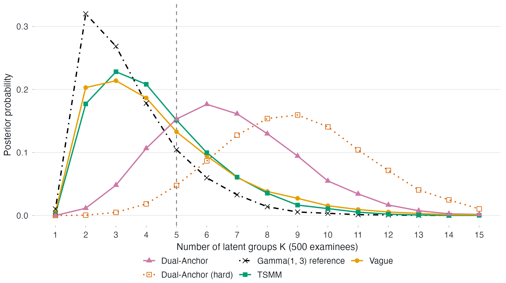

# Rasch model and score reliability

We analyse a vocabulary checklist for 500 respondents using 13 real-word items. The source has 16 checklist entries. To obtain the analysis sample, we sort respondent IDs as character strings, sample row positions with seed 81770971, and remove the nonwords VCL6, VCL9 and VCL12. The [data loader](code/refit/rasch/data_loader.R) checks the resulting response matrix. The sorting rule matters because numerical sorting would select a different sample.

## Compare counts and population densities

The posterior mean count ranges from about 3.51 under the Gamma(1,3) reference to 8.99 under the hard-constraint sensitivity prior. The separate Count-25 sensitivity gives a mean of about 11.72 and a mean largest population weight of .687. The external Gamma(1,3) reference follows the setting used in an earlier real-data analysis. [Paganin et al. (2023)](https://doi.org/10.3102/10769986221136105)

The population-density curves in [OSM Figure H.4](artifacts/osm-figure-H.4.png) average the fitted mixture density over posterior draws. A density of individual posterior means would instead reflect shrinkage and the limited information in each response vector. We include the population curves and their pointwise bands on a fixed grid; `rasch/03_density.R` checks their integrated mass and the normalization of the count distributions.

## Recalculate weighted-likelihood scores

~~~bash
Rscript rasch/01_wle.R
Rscript verification/check_rasch.R
~~~

For raw score $r$, fixed item difficulties $\beta_i$ and $p_i(\theta)=\operatorname{logit}^{-1}(\theta-\beta_i)$, the weighted-likelihood estimate solves

$$r-\sum_i p_i(\theta)+\frac{I'(\theta)}{2I(\theta)}=0,$$

where $I=\sum_i p_i(1-p_i)$ and $I'=\sum_i p_i(1-p_i)(1-2p_i)$. The correction follows [Warm (1989)](https://doi.org/10.1007/BF02294627). The [scoring function](code/common/R/wle.R) solves the equation and calculates the standard error $I^{-1/2}$. It gives finite estimates at scores zero and thirteen without altering the responses.

We calculate all 14 scores under each of six sets of item difficulties. Using the primary Dual-Anchor item estimates, reliability is

$$1-\frac{\overline{SE^2}}{s^2_{\mathrm{WLE}}}
=1-\frac{1.3119943}{4.5568397}\approx .7121.$$

The score frequencies weight the calculation over the 500 respondents, and the sample variance has denominator 499. This reliability is conditional on the posterior mean item difficulties supplied to the scoring function; uncertainty in those difficulties is not propagated.

[OSM Table H.11](artifacts/osm-table-H.11.html) gives the calculation by raw score. The 63 respondents with perfect scores have a conditional standard error of 1.733 logits. This illustrates the limited precision at the top of a short checklist.

## Compare person estimates across priors

~~~bash
Rscript rasch/02_posterior_summaries.R
Rscript rasch/03_density.R
~~~

Score-group frequencies and mean differences are sufficient to reconstruct the person-estimate RMSD. For Dual-Anchor versus Vague it is about .01227 logits. The largest absolute change is .03143 logits at score thirteen, with a negative signed difference and MCSE of about .016. The MCSE describes uncertainty due to posterior simulation. The Count-25 versus Vague RMSD is .02098 logits.

The diagnostic record includes ten fits corresponding to six distinct priors. Four sensitivity fits repeat a prior and fail the diagnostic rule; they are excluded from posterior comparisons. Five accepted fits require a third sampling schedule. [OSM Table H.13](artifacts/osm-table-H.13.html) and the [fit registry](records/rasch-fit-registry.csv) record the attempts and their diagnostic results.

## Compare the three vocabulary distributions

At a threshold of three logits, the posterior mean proportion of observed respondents with ability below or equal to the threshold is 0.473 under Gamma(1,1) and 0.475 under Dual-Anchor. The respective pointwise 95% intervals are [0.414, 0.534] and [0.414, 0.540]. Applying the same threshold to the posterior mean scores gives 279 of 500 respondents under both priors. The six population-density curves in Figure H.4 instead describe a new exchangeable respondent. [Finite CDFs](artifacts/osm-figure-H.2.png) · [Population densities](artifacts/osm-figure-H.4.png)

Across all ranks the Gamma–Dual RMS difference is 0.0181 logits. Within-prior chain splits give 0.0150 and 0.0167 logits, with half as many draws in each estimate. The downward movement at the upper tail is therefore difficult to distinguish from Monte Carlo variation. [Chain-split results](artifacts/osm-table-H.18.html)
