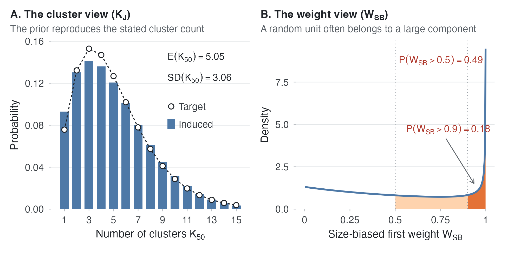

# Prior elicitation for Dirichlet process mixtures {.unnumbered}

This guide describes the replication code for *Design-Conditional Prior Elicitation for Dirichlet Process Mixtures: A Unified Framework for Cluster Counts and Weight Control* [@lee2026].

The concentration parameter affects both the number of occupied clusters in a sample and the distribution of probability among population clusters. We first choose a hyperprior to match a judgment about the number of clusters. We then examine its implications for the weights. When these implications are implausible, the Dual-Anchor procedure adjusts the prior and reports the resulting change in the count distribution.

We provide examples of prior calibration, a simulation study and applications to educational and psychometric data. The [getting-started chapter](01-start.qmd) gives the commands for rebuilding the tables and figures. This calculation uses the supplied simulation and model summaries, so it requires no new model fitting or respondent data. Subsequent chapters explain the analyses and show how to prepare source data and fit selected models.

| Analysis | Chapter |
|---|---|
| Count calibration and weight diagnostics | [Prior elicitation](03-prior-elicitation.qmd) |
| Simulation design and comparisons | [Simulation](04-simulation.qmd) |
| STAR, writing-to-learn and credit recovery | [Applications](05-applications.qmd) |
| Vocabulary responses and score reliability | [Rasch model](06-rasch-wle.qmd) |
| Verification and new model fits | [Verification and refitting](07-verification-refit.qmd) |

The [table and figure index](08-artifact-index.qmd) follows the 104 manuscript, including its online supplementary material (OSM). Each of the 62 entries links to its displayed result, calculation and numerical data.

## Reference {.unnumbered}

::: {#refs}
:::
